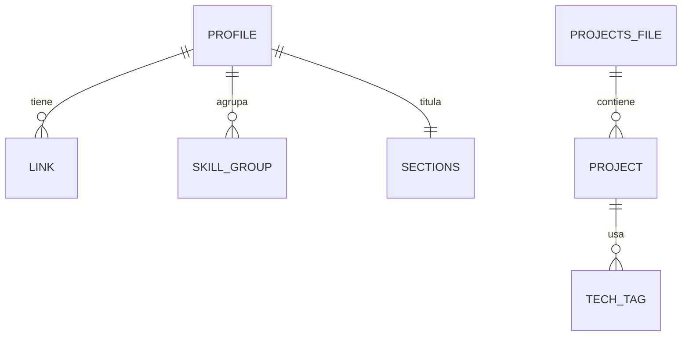

# DATA_MODEL: Portfolio_DavidPeralta

No hay base de datos: el "modelo" son dos archivos JSON. Las columnas base (id, created_at, updated_at) no aplican. Solo `projects[].id` es un slug.
La regla "copiar valores que cambian" tampoco aplica, porque no hay histórico.

## a) Diagrama

## b) `src/data/profile.json` (objeto raíz)
| Campo | Tipo | Reglas | Para investigar |
|---|---|---|---|
| name | string | Obligatorio, no vacío, ≤ 60 | JSON string, UTF-8 |
| role | string | Obligatorio, ≤ 60 | |
| tagline | string | Obligatorio, ≤ 140 | |
| bio | string | Obligatorio, ≤ 600 | |
| avatar | string o null | Ruta relativa bajo `src/assets/img/`, el archivo debe existir | ruta relativa vs absoluta en Pages |
| cv_url | string o null | Empieza por `https://` (reservado) | |
| sections | object | Claves obligatorias: about, projects, skills, contact (strings ≤ 30) | |
| links | array de LINK | ≥ 1 elemento | |
| skill_groups | array de SKILL_GROUP | ≥ 1 elemento | |

Reservados (nulables): `avatar` (foto opcional) y `cv_url` (PDF de CV a futuro).

### LINK (elemento de `links`)
| Campo | Tipo | Reglas | Para investigar |
|---|---|---|---|
| label | string | Obligatorio, ≤ 30 | |
| url | string | Empieza por `https://` o `mailto:` | `mailto:`, `rel="noopener noreferrer"`, `target="_blank"` |

### SKILL_GROUP (elemento de `skill_groups`)
| Campo | Tipo | Reglas | Para investigar |
|---|---|---|---|
| name | string | Obligatorio, ≤ 40 | |
| items | array de string | 1 a 12 elementos, cada uno ≤ 30 | |

## c) `src/data/projects.json` (objeto raíz con la clave `projects`)
### PROJECT (elemento de `projects`)
| Campo | Tipo | Reglas | Para investigar |
|---|---|---|---|
| id | string | Obligatorio, único, slug en minúsculas `[a-z0-9-]+` | slug |
| title | string | Obligatorio, ≤ 60 | |
| summary | string | Obligatorio, ≤ 200 | |
| tech | array de string | 1 a 8 elementos, cada uno ≤ 24 | |
| url_repo | string o null | `https://` o null | |
| url_demo | string o null | `https://` o null | |
| image | string o null | Ruta relativa bajo `src/assets/img/`, el archivo debe existir | `loading="lazy"`, atributo alt |
| year | integer | 2000 a 2100 | |
| order | integer | ≥ 1, único; menor = primero | |
| featured | boolean | Por defecto false (reservado) | |

Reservado (nulable): `image` (hasta tener capturas). `featured` es un reservado no nulable con default.

## d) Alcance
Dos archivos y unas 10 entradas máximo en v1. Sin paginación, ni búsqueda, ni filtros.

## e) Cómo se carga
`new URL('../data/<archivo>.json', import.meta.url)` para que funcione bajo la subruta de Pages. Investigar: `import.meta.url`, `fetch`, módulos ES, CORS con `file://` (por eso se usa `http.server` en local).
