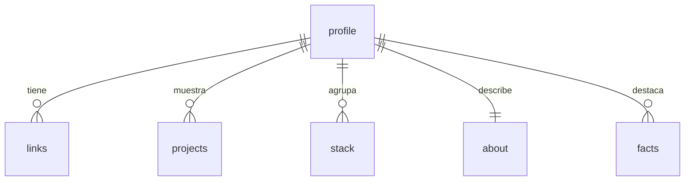

# DATA_MODEL — esquema de content.toml

No hay base de datos: la fuente de datos es `src/site/portfolio/content.toml`. Este documento define su esquema. Sin columnas base, `id` ni borrado lógico.

Claves de primer nivel obligatorias (las valida `content.py`): `profile`, `links`, `projects`, `stack`, `about`, `facts`.

## profile (tabla `[profile]`, una sola)
Propósito: identidad, textos del hero y pie.

| Campo | Tipo (TOML) | Parámetros | Para investigar |
|---|---|---|---|
| name | string | obligatorio, no vacío | TOML string |
| first_name | string | obligatorio (línea 1 del h1) | — |
| last_name | string | obligatorio (línea 2 del h1, en acento) | — |
| initials | string | obligatorio, 2 letras | — |
| status | string | obligatorio (ej. disponibilidad) | — |
| tagline | string | obligatorio, ≤ 160 caracteres | — |
| email | string | obligatorio | `mailto:`, ofuscación de correo |
| site_year | integer | obligatorio | — |
| footer_note | string | obligatorio | — |

## links (array `[[links]]`)
Propósito: botones de redes en la sección de contacto.

| Campo | Tipo | Parámetros | Para investigar |
|---|---|---|---|
| label | string | obligatorio | TOML array of tables |
| url | string | obligatorio, `https://` | `rel="noopener"` |

## projects (array `[[projects]]`)
Propósito: tarjetas de proyectos (3 en v1, grilla de 3 columnas).

| Campo | Tipo | Parámetros | Para investigar |
|---|---|---|---|
| title | string | obligatorio | — |
| kind | string | obligatorio (etiqueta corta) | — |
| summary | string | obligatorio, ≤ 200 caracteres | — |
| icon | string | uno de `chat`, `chart`, `terminal` | macros de Jinja2 |
| tags | array de string | 1–5 elementos | — |
| url | string | opcional (reservada, nula) | enlaces en tarjetas |
| featured | bool | sirve para mostrar que proyectos son los destacados

## stack (array `[[stack]]`)
Propósito: grupos de herramientas.

| Campo | Tipo | Parámetros | Para investigar |
|---|---|---|---|
| group | string | obligatorio | — |
| items | array de string | ≥ 1 elemento | — |

## about (tabla `[about]`, una sola)

| Campo | Tipo | Parámetros | Para investigar |
|---|---|---|---|
| heading | string | obligatorio | — |
| paragraphs | array de string | 1–3; admite `<strong>` | filtro `safe`, autoescape de Jinja2 |

## facts (array `[[facts]]`)
Propósito: tres datos destacados en "Sobre mí".

| Campo | Tipo | Parámetros | Para investigar |
|---|---|---|---|
| value | string | obligatorio | — |
| label | string | obligatorio | — |
