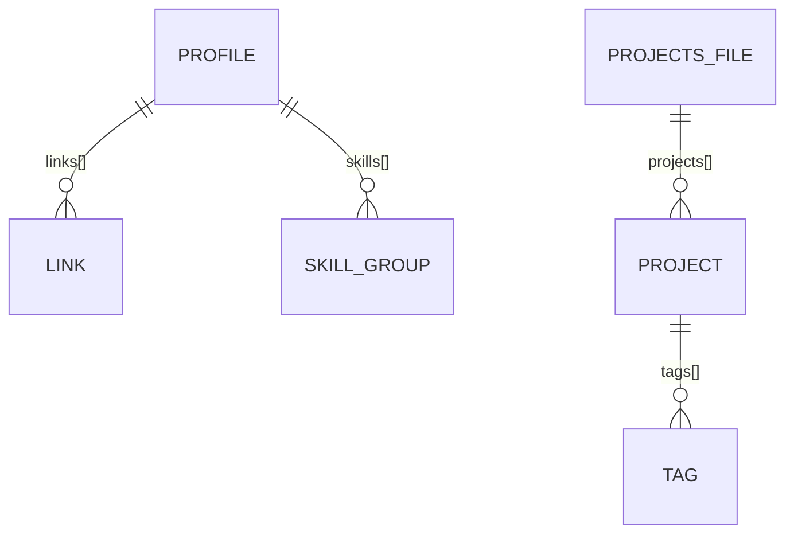

# docs/DATA_MODEL.md

No hay base de datos: el "modelo" son 2 archivos JSON en `src/data/`. Todos los textos se insertan con `textContent` (nunca `innerHTML`).

## a) Diagrama

## b) Campos base
No aplica: sin BD no hay id/created_at/updated_at globales. Cada proyecto lleva su propio `id`.

## c) Entidades

### profile (archivo `src/data/profile.json`, objeto raíz)
Propósito: datos de la persona y secciones Perfil, Habilidades y Contacto.

| Campo | Tipo | Parámetros | Para investigar |
|---|---|---|---|
| name | string | requerido, 1–60 caracteres | textContent |
| role | string | requerido, ≤ 60 | — |
| tagline | string | requerido, ≤ 140 | — |
| about | string | requerido, ≤ 600 | — |
| avatar | string o null | ruta relativa `src/assets/img/...`, default null | rutas relativas en GitHub Pages, loading="lazy" |
| links | array de link | requerido, ≥ 1 | rel noopener noreferrer |
| skills | array de skill_group | requerido, ≥ 1 | — |

### link (elemento de `profile.links`)
| Campo | Tipo | Parámetros | Para investigar |
|---|---|---|---|
| label | string | requerido, ≤ 30 | — |
| url | string | requerido, empieza con `https://` o `mailto:` | esquemas de URL, XSS por href |

### skill_group (elemento de `profile.skills`)
| Campo | Tipo | Parámetros | Para investigar |
|---|---|---|---|
| group | string | requerido, ≤ 30 | — |
| items | array de string | requerido, ≥ 1, cada uno ≤ 30 | — |

### projects (archivo `src/data/projects.json`, objeto raíz `{"projects": [...]}`)
Propósito: lista de proyectos de la sección Proyectos.

| Campo | Tipo | Parámetros | Para investigar |
|---|---|---|---|
| id | string | requerido, único, kebab-case | — |
| name | string | requerido, ≤ 60 | — |
| summary | string | requerido, ≤ 200 | — |
| tags | array de string | requerido, ≥ 1, cada uno ≤ 20 | — |
| repo_url | string | requerido, empieza con `https://` | — |
| demo_url | string o null | default null; si existe, empieza con `https://` | — |
| order | integer | requerido, ≥ 1; orden ascendente | Array.prototype.sort |

## d) Reservadas
Ninguna.

## e) Valores que cambian
No aplica en v1.

## f) Ejemplo mínimo válido
Ver los JSON que crea `scaffold.sh`.
